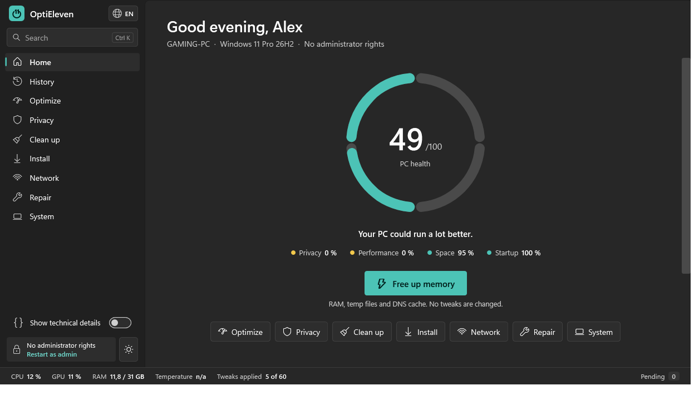
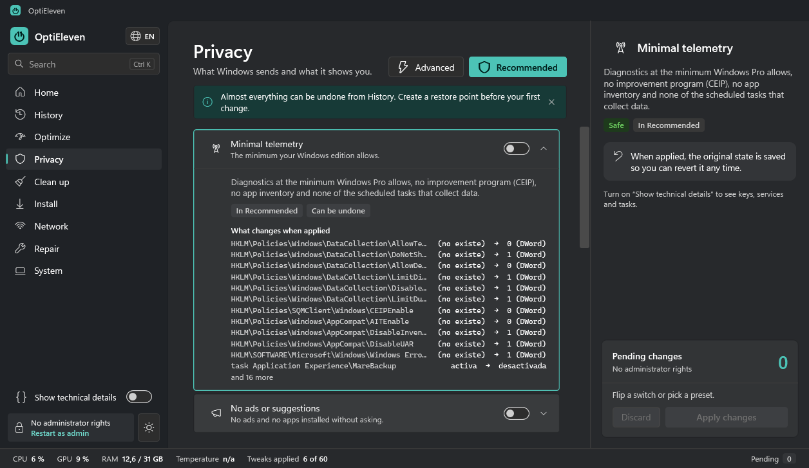
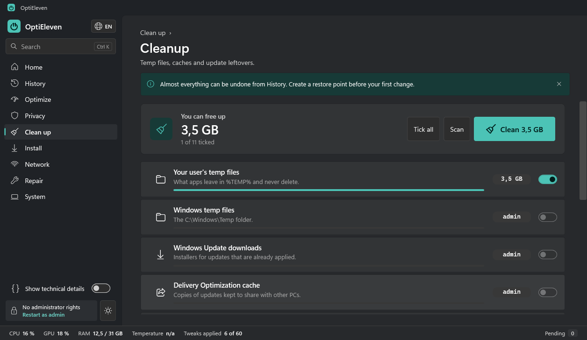

<div align="center">


# OptiEleven

**Tu Windows 11, en un solo sitio.**
Limpia, libera memoria, ajusta la privacidad y el rendimiento, instala apps y repara Windows. Todo se puede deshacer.

[](LICENSE)


**Ábrelo con un comando.** Pega esto en PowerShell:

```powershell
irm optieleven.app | iex
```

o [descarga OptiEleven.zip](https://github.com/bila4l4/OptiEleven/releases/latest/download/OptiEleven.zip), descomprímelo y haz doble clic en `OptiEleven.exe`. Web: **[optieleven.app](https://optieleven.app)**

[English](README.md) · Español



</div>

## Por qué OptiEleven

- **Ves antes de aplicar.** Cada ajuste enseña en *Más info* los valores del registro, servicios y tareas que cambia, con el valor de ahora y el de después.
- **Todo se puede deshacer.** La primera vez que aplicas un ajuste se guarda cómo estaba. **Historial** lista cada cambio con su fecha y deja deshacer cada uno, aunque hayan pasado meses.
- **Las tareas del PC en un solo sitio.** Liberar memoria, limpiar el disco, instalar apps, arreglar la red y reparar Windows sin buscar por Configuración.
- **Sin instalación y sin telemetría propia.** Es PowerShell + WPF. Los scripts están en texto plano junto al exe: léelos, ejecútalos y borra la carpeta.

## Qué hace

| | |
|---|---|
| **Inicio** | Una nota de 0 a 100 para tu PC, repartida en privacidad, rendimiento, espacio y arranque. Pasa el ratón para ver el detalle y pulsa para arreglarlo. **Liberar memoria** libera RAM y temporales con un clic, sin cambiar ningún ajuste. |
| **Optimizar** | Ajustes de rendimiento, latencia y juegos, **Sesión de juego** (cierra lo que sobra mientras juegas y lo devuelve al terminar), ajustes por juego y apps de inicio. |
| **Privacidad** | Telemetría, anuncios y sugerencias, Copilot y Recall, historial de actividad, Bing en Inicio y servicios de diagnóstico. |
| **Limpiar** | Temporales, restos de actualizaciones, cachés y volcados, con lo que ocupa cada cosa; un árbol de **espacio en disco** como WinDirStat; y quitar apps preinstaladas. |
| **Instalar** | Más de 100 apps con winget, con sus logos y actualizar todo, o un instalador de un solo archivo para otro PC. |
| **Red** | DNS con un clic (Cloudflare, Google, Quad9), latencia y test de velocidad. |
| **Reparar** | DISM + SFC, comprobar disco, restablecer la red, Windows Update y la Store, caché de iconos e informe de batería. |
| **Sistema** | El hardware de tu PC, ajustes de Windows Update, interfaz y servicios, copias y perfiles. |
| **Historial** | Cada cambio con su fecha, qué cambió antes y después, y deshacer. |
| **Búsqueda** | **Ctrl+K** encuentra cualquier herramienta o ajuste por su nombre. |

60 ajustes con su nivel de riesgo y dos presets: *Recomendado* (seguro para casi cualquier PC) y *Avanzado*. En español e inglés, claro y oscuro.

<table>
<tr>
<td></td>
<td></td>
</tr>
</table>

## Empezar

1. Clic derecho en el botón Inicio → **Terminal**, pega el comando y pulsa Enter. Acepta el aviso de administrador.

   ```powershell
   irm optieleven.app | iex
   ```

   Descarga la última versión en `%LOCALAPPDATA%\OptiEleven`, la comprueba con el `SHA256SUMS.txt` de la release y la abre. Si lo vuelves a ejecutar, la actualiza. Si quieres, [lee el script](run.ps1) antes; es corto.

   ¿Prefieres un archivo? **[Descarga OptiEleven.zip](https://github.com/bila4l4/OptiEleven/releases/latest/download/OptiEleven.zip)**, descomprímelo donde quieras y haz doble clic en **`OptiEleven.exe`**. Es un lanzador pequeño que ejecuta `OptiEleven.ps1` de la misma carpeta. Si el exe está bloqueado, `OptiEleven.cmd` hace lo mismo.
2. Empieza por **Inicio**: pulsa **Liberar memoria** o el trozo del anillo que quieras mejorar.
3. Para aplicar ajustes, actívalos, revisa la hoja de cambios y pulsa **Aplicar cambios**. El panel te ofrece antes un punto de restauración. Reinicia si te lo pide.

Requisitos: Windows 11 22H2 o posterior. PowerShell 5.1 y .NET ya vienen con Windows. Sin permisos de administrador el panel se abre en solo lectura, así que puedes mirar sin riesgo.

### Línea de comandos

```powershell
.\OptiEleven.ps1 -Status                         # estado de cada ajuste, no cambia nada
.\OptiEleven.ps1 -Preset Recomendado -NoGui      # aplica un preset sin interfaz (admin)
.\OptiEleven.ps1 -Config perfil.json -NoGui      # aplica un perfil exportado (admin)
.\OptiEleven.ps1 -Page cleanup                   # abre directamente una página (el id de su tool.json)
```

## ¿Es seguro?

OptiEleven cambia ajustes del sistema, así que lee qué hace cada uno antes de aplicarlo. El diseño intenta que no te metas en líos:

- Las copias del estado original están en `%ProgramData%\OptiEleven\secure`, una carpeta en la que solo pueden escribir los administradores.
- El panel ofrece crear un punto de restauración antes de aplicar.
- Los ajustes que no se pueden deshacer desde el panel (por ejemplo desinstalar Edge u OneDrive) están marcados y se repiten en la confirmación.
- Los ajustes con riesgo están marcados como *Moderado* o *Avanzado* y dicen a qué afectan.

Si algo sale mal, abre una [incidencia](../../issues) con el registro de **Actividad** (activa *Mostrar detalles técnicos*).

## Instalación limpia de Windows (opcional)

¿Quieres empezar desde una ISO limpia? Hay una [guía de NTLite](docs/ntlite-guide.es.md) paso a paso para crear una imagen ligera de Windows 11 Pro que sigue recibiendo actualizaciones, y OptiEleven hace después la parte reversible.

## Contribuir

Los avisos de errores, ajustes nuevos, herramientas nuevas y traducciones son bienvenidos. Cada herramienta y cada ajuste es su propio archivo; mira [CONTRIBUTING.md](CONTRIBUTING.md).

Si OptiEleven te ha servido, una ⭐ ayuda a que otros lo encuentren.

## Créditos

- Iconos: Segoe Fluent Icons (vienen con Windows), [Phosphor Icons](https://phosphoricons.com) (MIT) y [Simple Icons](https://simpleicons.org) (CC0). Los logos de marcas son de sus dueños. Mira [THIRD-PARTY.md](THIRD-PARTY.md).
- Ideas de las herramientas de la comunidad que vinieron antes: [Optimizer](https://github.com/hellzerg/optimizer), [WinUtil](https://github.com/ChrisTitusTech/winutil), [ReviOS](https://revi.cc) y otras.

## Licencia

[MIT](LICENSE). OptiEleven no está afiliado a Microsoft.
