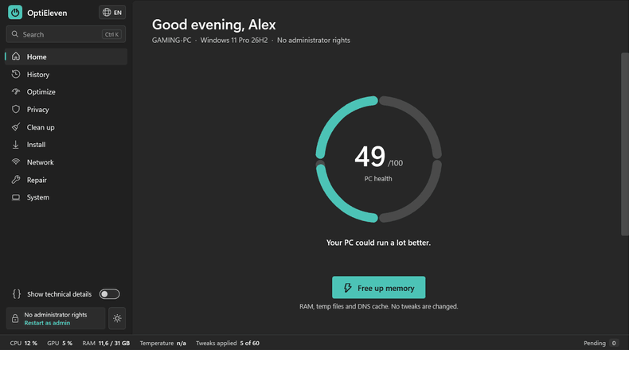
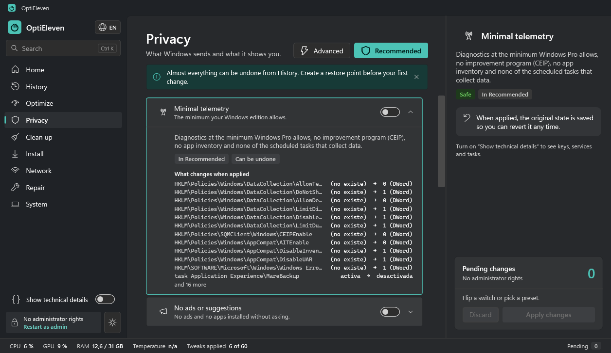
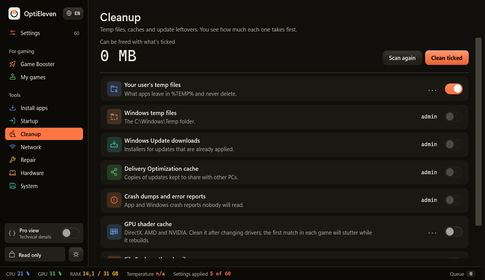

<div align="center">


# OptiEleven

**Your Windows 11, in one place.**
Clean up, free memory, tune privacy and performance, install apps and repair Windows. Every change can be undone.

[](LICENSE)


**Open it with one command.** Paste this in PowerShell:

```powershell
irm optieleven.app | iex
```

or [download OptiEleven.zip](https://github.com/bila4l4/OptiEleven/releases/latest/download/OptiEleven.zip), extract it and double-click `OptiEleven.exe`. Website: **[optieleven.app](https://optieleven.app)**

English · [Español](README.es.md)



</div>

## Why OptiEleven

- **See before you apply.** Every tweak shows the registry values, services and tasks it changes, with the value now and the value after, under *More info*.
- **Everything is reversible.** The original state is saved the first time a tweak is applied. **History** lists every change with its date and lets you undo each one, even months later.
- **One place for the PC chores.** Free memory, clean up disk space, install apps, fix the network and repair Windows without hunting through Settings.
- **No install, no telemetry of its own.** It's PowerShell + WPF. The scripts sit in plain text next to the exe: read them, run them, delete the folder.

## Features

| | |
|---|---|
| **Home** | A 0-100 health score for your PC split into privacy, performance, space and startup. Hover a part to see the detail and click it to fix it. **Free up memory** frees RAM and temp files in one click, without changing any tweak. |
| **Optimize** | Performance, latency and game tweaks, **Game session** (closes what you don't need while you play and brings it back after), per-game settings and startup apps. |
| **Privacy** | Telemetry, ads and suggestions, Copilot and Recall, activity history, Bing in Start and diagnostic services. |
| **Clean up** | Temp files, update leftovers, caches and crash dumps, with the size of each first; a WinDirStat-style **disk space** tree; and removal of preinstalled apps. |
| **Install** | Over 100 apps through winget with real logos and update-all, or a one-file installer for another PC. |
| **Network** | DNS in one click (Cloudflare, Google, Quad9), latency and a speed test. |
| **Repair** | DISM + SFC, disk check, network reset, Windows Update reset, Store reset, icon cache and battery report. |
| **System** | Your PC's hardware, Windows Update, interface and service tweaks, backups and profiles. |
| **History** | Every change with its date, what it changed before and after, and undo. |
| **Search** | **Ctrl+K** finds any tool or tweak by name. |

60 tweaks with a risk level and two presets: *Recommended* (safe for almost every PC) and *Advanced*. English and Spanish, light and dark.

<table>
<tr>
<td></td>
<td></td>
</tr>
</table>

## How it compares

OptiEleven isn't the first tool of its kind, and some are much bigger and older:

- **[WinUtil](https://github.com/ChrisTitusTech/winutil)**: the most popular, with a large app catalog (winget and Chocolatey), tweaks, fixes and Windows Update settings. Choose it for the widest set of options and a big community.
- **[Win11Debloat](https://github.com/Raphire/Win11Debloat)**: a lightweight script focused on removing preinstalled apps and telemetry. Choose it for a quick, scriptable debloat.
- **[Sophia Script](https://github.com/farag2/Sophia-Script-for-Windows)**: a very complete PowerShell module for fine-tuning Windows, for people comfortable editing a script.
- **[Optimizer](https://github.com/hellzerg/optimizer)**: a C# app with tweaks, cleanup and hosts-file editing.

OptiEleven focuses on something else: seeing the exact change before it happens, a dated history where each change can be undone, and everyday tools (memory, disk space, cleanup, repairs) in one native-looking app. It's new and maintained by one person, so it has fewer options and less real-world testing than those projects.

## Get started

1. Right-click the Start button → **Terminal**, paste the command and press Enter. Accept the administrator prompt.

   ```powershell
   irm optieleven.app | iex
   ```

   It downloads the latest release into `%LOCALAPPDATA%\OptiEleven`, checks it against the release's `SHA256SUMS.txt` and opens it. Running it again updates it. [Read the script](run.ps1) first if you like; it's short.

   Prefer a file? **[Download OptiEleven.zip](https://github.com/bila4l4/OptiEleven/releases/latest/download/OptiEleven.zip)**, extract it anywhere and double-click **`OptiEleven.exe`**. It's a small launcher that runs `OptiEleven.ps1` from the same folder. If the exe is blocked, `OptiEleven.cmd` does the same thing.
2. Start on **Home**: press **Free up memory**, or click the part of the ring you want to improve.
3. To apply tweaks, flip them, review the change sheet and press **Apply changes**. The panel offers a restore point first. Restart if it asks you to.

Requirements: Windows 11 22H2 or later. PowerShell 5.1 and .NET are already part of Windows. Without administrator rights the panel opens read-only, so you can look around safely first.

### Command line

See the state of every tweak on your PC without changing anything:

```text
PS> .\OptiEleven.ps1 -Status
Category    Tweak                             Risk     Presets Applied
--------    -----                             ----     ------- -------
Privacy     Minimal telemetry                 Safe     R,A     no
Privacy     No ads or suggestions             Safe     R,A     no
Privacy     No Copilot or Recall              Safe     R,A     no
...
```

Other options:

```powershell
.\OptiEleven.ps1 -Status                         # show the state of every tweak, changes nothing
.\OptiEleven.ps1 -Preset Recomendado -NoGui      # apply a preset without the UI (admin)
.\OptiEleven.ps1 -Config profile.json -NoGui     # apply an exported profile (admin)
.\OptiEleven.ps1 -Page cleanup                   # open straight on a page (the id in its tool.json)
```

## Is it safe?

OptiEleven changes system settings, so read what each one does before you apply it. The design tries hard to keep you out of trouble:

- Backups of the original state live in `%ProgramData%\OptiEleven\secure`, a folder only administrators can write to.
- The panel offers to create a system restore point before applying.
- Tweaks that can't be undone from the panel (for example uninstalling Edge or OneDrive) are labelled and listed again in the confirmation.
- Risky tweaks are tagged *Moderate* or *Advanced* and say what they affect.

If something goes wrong, open an [issue](../../issues) with the **Activity** log (turn on *Show technical details*).

### Code signing policy

Releases are built from this repository by [GitHub Actions](.github/workflows/release.yml), and the zip's SHA256 is published with each release. We have applied to [SignPath Foundation](https://signpath.org) for free code signing. Until it's approved, releases are **unsigned**, so Windows SmartScreen may warn the first time. Once approved, the exe, the native DLL and the scripts are signed with: *Free code signing provided by SignPath.io, certificate by SignPath Foundation.*

- Committers and reviewers: [bila4l4](https://github.com/bila4l4)
- Approvers: [bila4l4](https://github.com/bila4l4)

Privacy: OptiEleven doesn't send any information anywhere unless you ask it to. The only network connections are the ones you start: downloading or updating OptiEleven, installing apps with winget and running the network speed test.

## Roadmap

Plans, not promises. See the [CHANGELOG](CHANGELOG.md) for what already shipped.

- Signed releases through SignPath Foundation (applied, waiting for approval).
- A page on the website for each tweak, generated from its `.tweak.json`, explaining what it changes.
- Translations keyed by id, so adding a language is easier.
- More testing on clean Windows 11 installs and virtual machines.
- Install apps and Repair without encoded commands.

Ideas and votes are welcome in [issues](../../issues).

## Clean Windows install (optional)

Want to start from a clean ISO? There's a step-by-step [NTLite guide](docs/ntlite-guide.es.md) (Spanish) for building a lean Windows 11 Pro image that still gets updates, with OptiEleven doing the reversible part afterwards.

## Contributing

Bug reports, new tweaks, new tools and translations are very welcome. Each tool and each tweak is its own file; see [CONTRIBUTING.md](CONTRIBUTING.md).

If OptiEleven helped your PC, a ⭐ helps other people find it.

## Credits

- Icons: Segoe Fluent Icons (part of Windows), [Phosphor Icons](https://phosphoricons.com) (MIT) and [Simple Icons](https://simpleicons.org) (CC0). Brand logos belong to their owners. See [THIRD-PARTY.md](THIRD-PARTY.md).
- Ideas from the community tools that came before it: [Optimizer](https://github.com/hellzerg/optimizer), [WinUtil](https://github.com/ChrisTitusTech/winutil), [ReviOS](https://revi.cc) and others.

## License

[MIT](LICENSE). OptiEleven is not affiliated with Microsoft.
