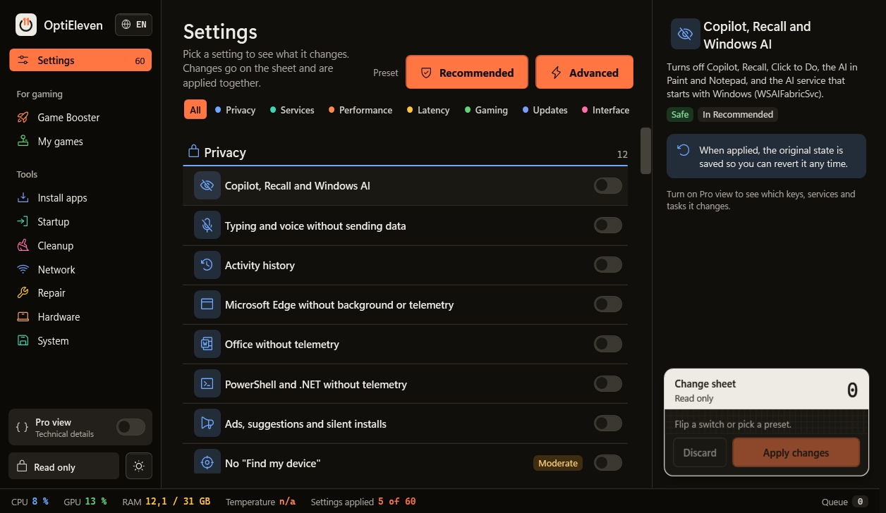
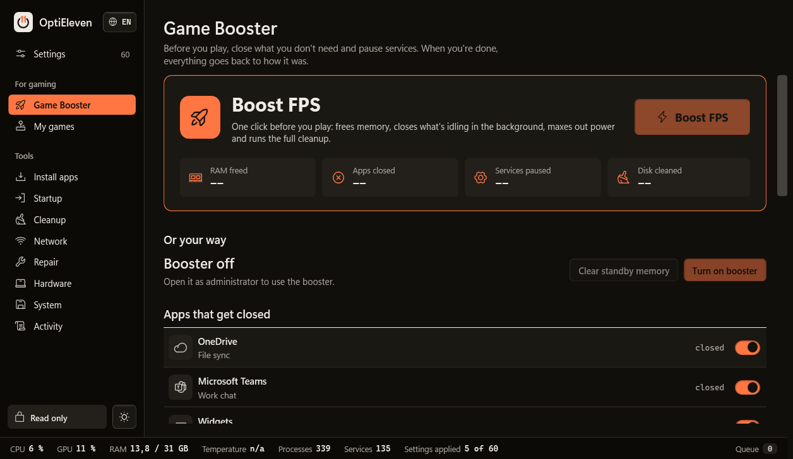
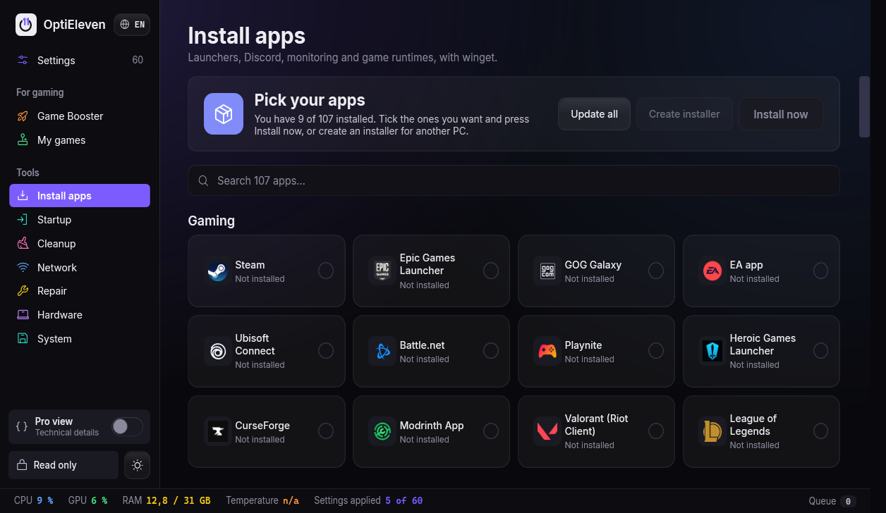
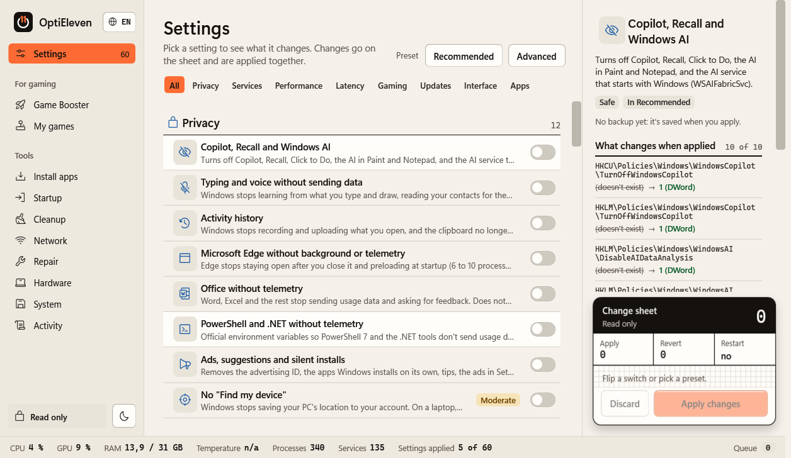
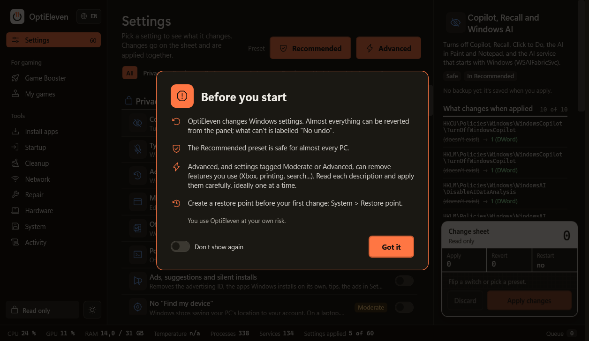

<div align="center">


# OptiEleven

**A reversible Windows 11 optimizer for gaming.**
Strip telemetry and bloat, free RAM before you play, and undo any change with one click.

[](LICENSE)


**Open it with one command.** Paste this in PowerShell:

```powershell
irm bila4l4.github.io/OptiEleven | iex
```

or [⬇ download OptiEleven.zip](https://github.com/bila4l4/OptiEleven/releases/latest/download/OptiEleven.zip), extract it and double-click `OptiEleven.cmd`. Nothing to build or install.

English · [Español](README.es.md)



</div>

## Why OptiEleven

Most "debloat" scripts are a wall of registry edits you run once and hope for the best. OptiEleven works the other way round:

- **See before you apply.** Every setting shows exactly which registry values, services and scheduled tasks it touches, with the value now and the value after.
- **Everything is reversible.** The first time a setting is applied, the original state is saved. *Revert* puts it back, even months later.
- **Nothing happens until you press Apply.** Switches go on a change sheet; you review the list, optionally create a restore point, then apply them together.
- **No install, no telemetry of its own.** It's a PowerShell + WPF app. Read the code, run it, delete the folder.

## Features

| | |
|---|---|
| **60 tweaks in 8 categories** | Privacy, Services, Performance, Latency, Gaming, Windows Update, Interface, Apps. Two presets: *Recommended* (safe, removes almost everything useless) and *Advanced* (more aggressive, read the notes). |
| **Boost FPS** | One click before you play: closes background apps, pauses services, sets power to maximum, frees RAM and runs the full cleanup. *Finish and restore* puts everything back. |
| **Game Booster** | Pick exactly which apps get closed and which services get paused while you play. |
| **My games** | Finds your Steam, Epic and GOG games and sets per-game options: high-performance GPU, high priority, no fullscreen optimizations. |
| **Install apps** | Launchers, Discord, OBS, monitoring tools and game runtimes through winget, with update-all. |
| **Startup** | See and switch off what starts with Windows. |
| **Cleanup** | Temp files, update leftovers, crash dumps, shader cache, thumbnails, Recycle Bin. Shows the size of each first. |
| **Network** | Latency to your router and to Cloudflare, Google and Quad9, and switch DNS in one click. |
| **Repair** | DISM + SFC, disk check, network reset, Windows Update reset, Store reset, icon cache, battery report. |
| **Hardware** | CPU, GPU, RAM speed, disks, Secure Boot, TPM, VBS and HAGS state, with a copyable report. |
| **Profiles** | Export your settings to a `.json` and import them on another PC, or apply them from the command line. |
| **Languages** | English and Spanish. Adding a language is one JSON file ([how](CONTRIBUTING.md#translations)). |
| **Themes** | Dark (default) and light. |

<table>
<tr>
<td></td>
<td></td>
</tr>
<tr>
<td></td>
<td></td>
</tr>
</table>

## Get started

1. Right-click the Start button → **Terminal**, paste the command below and press Enter. Accept the administrator prompt.

   ```powershell
   irm bila4l4.github.io/OptiEleven | iex
   ```

   It downloads the latest release into `%LOCALAPPDATA%\OptiEleven`, and running it again updates it. [Read the script](run.ps1) first if you like; it's short.

   Prefer a file? **[Download OptiEleven.zip](https://github.com/bila4l4/OptiEleven/releases/latest/download/OptiEleven.zip)**, extract it anywhere and double-click **`OptiEleven.cmd`**.
2. The panel opens as administrator.
3. Read the start notice, go to **System → Restore point**, then pick the **Recommended** preset, review the change sheet and press **Apply changes**.
4. Restart if the panel asks you to.

Requirements: Windows 11. PowerShell 5.1 and .NET are already part of Windows. Without administrator rights the panel opens in read-only mode, so you can look around safely first.



### Command line

```powershell
.\OptiEleven.ps1 -Status                         # show the state of every tweak, changes nothing
.\OptiEleven.ps1 -Preset Recomendado -NoGui      # apply a preset without the UI (admin)
.\OptiEleven.ps1 -Config profile.json -NoGui     # apply an exported profile (admin)
.\OptiEleven.ps1 -Page booster                   # open straight on a page (the id in its tool.json)
```

## Is it safe?

OptiEleven changes system settings, so read what each one does before you apply it. The design tries hard to keep you out of trouble:

- Backups of the original state live in `%ProgramData%\OptiEleven\secure`, a folder only administrators can write to.
- The panel offers to create a system restore point before every apply.
- Settings that can't be undone from the panel (for example uninstalling Edge or OneDrive) are labelled **No undo** and listed again in the confirmation.
- Risky settings are tagged *Moderate* or *Advanced* and say what breaks (for example *Xbox services*: don't use it with Game Pass).

If something goes wrong, open an [issue](../../issues) with the **Activity** log (System → Backups opens the folder with `panel.log`).

## Clean Windows install (optional)

Want to start from a clean ISO? There's a step-by-step [NTLite guide](docs/ntlite-guide.es.md) (Spanish) for building a lean Windows 11 Pro image that still gets updates, with OptiEleven doing the reversible part afterwards.

## Contributing

Bug reports, new tweaks and translations are very welcome. See [CONTRIBUTING.md](CONTRIBUTING.md).

If OptiEleven helped your PC, a ⭐ helps other people find it.

## Credits

- Icons: [Phosphor Icons](https://phosphoricons.com) (MIT) and [Simple Icons](https://simpleicons.org) (CC0). Brand logos belong to their owners. See [THIRD-PARTY.md](THIRD-PARTY.md).
- Ideas from the community tools that came before it: [Optimizer](https://github.com/hellzerg/optimizer), [WinUtil](https://github.com/ChrisTitusTech/winutil), [ReviOS](https://revi.cc) and others.

## License

[MIT](LICENSE). OptiEleven is not affiliated with Microsoft.
